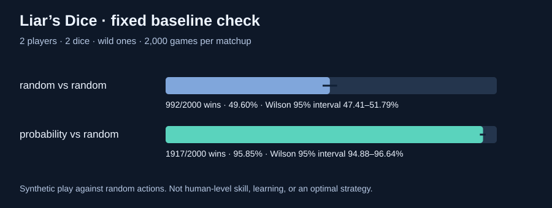

# liar's dice: hidden-information simulation

a liar's dice engine with explicit rules, private player observations and reproducible policy comparisons.

the runnable implementation uses dependency-free Python 3.10+. the original Julia simulator/POMDP sketch is preserved in `original/`; this november 2026 revision adds a Python port, tests and documentation. see [provenance](docs/PROVENANCE.md) for what changed. no learned policy or equilibrium solver is claimed.



## run

from this folder, with Python 3.10 or newer:

```sh
python3 -m unittest discover -s tests -v
python3 -m liars_dice demo --seed 42
python3 -m liars_dice benchmark --games 2000 --seed 20261101 --output /tmp/dice-benchmark.json
```

no package installation, credentials, network or external data are needed. on Windows, use `py` in place of `python3` and choose a Windows output path. the source is portable, but the executed acceptance checks were on Linux/Python 3.12, not Windows/macOS. an existing output file is never overwritten.

optional installation: `python3 -m pip install .` provides the `liars-dice` command. installation needs setuptools in the build environment; the module commands above do not.

## implementation

- immutable full game state, separate observation type, and deterministic replay from explicit RNG seeds.
- multiplayer elimination and a finite, monotone bidding ladder.
- challenge resolution, round rewards and complete game win detection.
- observation-only random and probability-based reference policies.
- a balanced-seat/starter benchmark with per-game JSON records and uncertainty intervals.
- exhaustive small-dice probability checks, transition tests and multiplayer invariants.

## rules

players are numbered from 0 in Python. each starts with the same number of fair six-sided dice; each round begins with fresh independent rolls.

1. a bid `(quantity, face)` means at least that many matching dice across all live players.
2. bids increase lexicographically: a higher quantity, or the same quantity with a higher face. a bid may not exceed the total number of remaining dice. this includes bids on ones; there is no special ones conversion rule.
3. ones are wild for bids on 2–6 by default. for a bid on ones, only ones count. `Rules(..., ones_wild=False)` disables wild ones.
4. calling is legal only after a bid. if the bid is true, the caller loses one die; otherwise the bidder loses one. exact equality is a true bid.
5. every player rerolls. the next live player strictly after the loser starts the next round. players at zero dice are skipped. this starter rule follows the intent of the original prototype; it differs from common variants where the loser starts.
6. the last player with dice wins the game. a challenge winner need not be the final game winner.
7. a challenge produces round rewards `+1` to its winner, `−1` to its loser, and `0` to uninvolved players. bids have zero reward. benchmark scores use final wins, not summed round rewards.

the engine supports 2–10 players and 1–10 initial dice each. the included benchmark is specifically two players, two dice, wild ones. there is no betting, money, online play, or connection to a gambling service.

## hidden information and the probability baseline

a policy receives only its own dice, public dice counts, the current bid/bidder, current-round bid history and legal actions. the simulator's full state is never passed to it. terminal observations have no legal actions. trace output intentionally reveals dice after a challenge for auditing; it is not policy input.

for a candidate bid, the probability baseline counts its own matching dice and computes a binomial tail for the unseen dice: success probability `1/6`, or `2/6` for a non-one face with wild ones. it calls if the current bid has less than 50% probability; otherwise it makes the most probable legal bid, breaking ties toward the smallest bid.

limitation: this calculation ignores the information in opponents' strategic bids. it is an independent-fair-dice prior conditioned on one's own hand, not a correct posterior after informative bidding. the policy is a fixed heuristic, not a POMDP solution, optimal strategy or model of human bluffing.

## results

the checked-in run uses 2,000 independent game seeds per matchup, beginning at 20261101. focal seat and starting seat cover all four combinations equally. dice and policy randomness use separate explicit RNG streams. the 0.5 threshold was fixed before the recorded benchmark, not selected for best results.

| focal policy vs opponent | wins | win rate | 95% wilson interval |
|---|---:|---:|---:|
| random vs random | 992 / 2000 | 49.60% | 47.41–51.79% |
| probability vs random | 1917 / 2000 | 95.85% | 94.89–96.64% |

these are synthetic outcomes against an intentionally weak, uniformly random legal-action policy. they do not demonstrate skill against humans, learned agents or equilibrium opponents. wilson intervals describe monte carlo uncertainty for this fixed design; they do not account for model/rule mismatch. both matchups reuse the same seed range; they are not independent of each other. different Python versions may change RNG implementation details: reproduce the exact recorded records with Python 3.12.

full records: [`results/benchmark.json`](results/benchmark.json). a single auditable game: [`results/demo.json`](results/demo.json). [verification receipt](docs/VERIFICATION.md).

## files

- `liars_dice/engine.py`: rules, state, observations, transitions.
- `liars_dice/policies.py`: random and binomial-prior baseline.
- `liars_dice/simulation.py`: game loop and balanced evaluation.
- `liars_dice/__main__.py`: CLI with argument validation/no-clobber output.
- `tests/`: standard-library tests; no testing dependency required.
- `original/`: unchanged upstream text snapshot (not a release entry point).
- `julia_preview/`: statically repaired Julia core, not executed here.

the provenance notes distinguish the original Julia implementation from the november 2026 Python port, repairs, tests and documentation.
